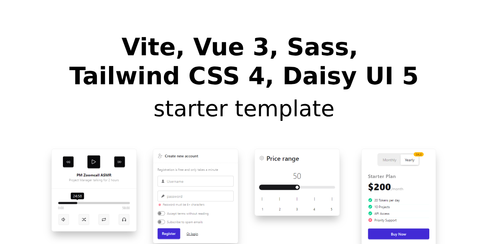

# Template: Vite + Vue 3 + Sass + Tailwind 4 + DaisyUI 5


A ready-to-use starting point for Vue 3 projects. It builds on the [Vite + Vue 3 template](https://vite.new/vue) and adds the pieces you would otherwise wire up by hand:

- ✅ [Vite](https://vite.dev/) for the build tool
- ✅ [Vue 3](https://vuejs.org/) for the frontend
- ✅ [Vue Router](https://router.vuejs.org/) for routing
- ✅ [Sass](https://sass-lang.com/) for styling
- ✅ [Tailwind CSS 4](https://tailwindcss.com/) for styling
- ✅ [DaisyUI 5](https://daisyui.com/) for additional Tailwind CSS components
- ✅ [Vitest](https://vitest.dev/) + [Vue Test Utils](https://test-utils.vuejs.org/) for unit tests
- ✅ [ESLint](https://eslint.org/) for linting, with accessibility rules
- ✅ [Yarn 4](https://yarnpkg.com/) via Corepack, with a 7-day minimum dependency age
- ✅ **Theme configuration** (light, dark, system, ...) with live colour swatches
- ✅ **28 UI blocks (components)** pre-configured with DaisyUI, in a searchable, filterable preview
- ✅ **GitHub Actions** for CI and GitHub Pages deployment

## Demo
- 🌐 [https://tpl-vue3-tailwind4-daisyui5.brown.sk/](https://tpl-vue3-tailwind4-daisyui5.brown.sk/)

## Upgrading from v1
v2 switches the package manager to Yarn 4 and changes how Tailwind is configured.
See [CHANGELOG.md](CHANGELOG.md) for the full list of breaking changes.

## Requirements
- Node.js 20.19+, or 22.12+ (Vite 8 rejects 22.0-22.11)
- Corepack (bundled with Node.js): `corepack enable`

## Template initialisation by forking (recommended) 🍴
⏩ Use GitHub's template feature to create a new repository based on this template:

→ [Create a repository from this template](https://github.com/new?template_name=starter-template-vite-vue3-sass-tailwind4-daisyui5&template_owner=martinille) ←

## Template initialisation by cloning
⏩ Clone the repository:
```bash
git clone https://github.com/martinille/starter-template-vite-vue3-sass-tailwind4-daisyui5.git <project-name>
```

⏩ Change the directory:
```bash
cd <project-name>
```

⏩ Remove the `.git` directory:
```bash
rm -rf .git
```

⏩ Enable Corepack and install the dependencies:
```bash
corepack enable
yarn install
```

## Scripts
| Command              | Description                                 |
|----------------------|---------------------------------------------|
| `yarn dev`           | Start the Vite dev server with HMR          |
| `yarn build`         | Build the project into `dist/`              |
| `yarn preview`       | Preview the production build locally        |
| `yarn test`          | Run the unit tests once                     |
| `yarn test:watch`    | Run the unit tests in watch mode            |
| `yarn test:coverage` | Run the unit tests with a coverage report   |
| `yarn lint`          | Lint the project                            |
| `yarn lint:fix`      | Lint the project and apply the fixes        |

## Dependency updates
`renovate.json` configures [Renovate](https://docs.renovatebot.com/) with the same 7-day
`minimumReleaseAge` as the install gate, so update pull requests never propose a version
Yarn would refuse to install. It only runs once you install the Renovate GitHub App on
the repository - delete the file if you prefer Dependabot or manual updates.

## Dependency safety
`.yarnrc.yml` sets `npmMinimalAgeGate: 10080`, so Yarn refuses to install any package
version published less than 7 days ago. Compromised releases are usually detected and
unpublished within hours, so the delay keeps a freshly backdoored version out of the
project. Use `npmPreapprovedPackages` to whitelist a package when a security patch has
to land immediately.

## Testing
Tests run on [Vitest](https://vitest.dev/) in a jsdom environment and live next to the
code they cover, as `*.test.js`. There is no `vitest.config.js` - the configuration is the
`test` block in `vite.config.js`. `src/test/setup.js` stubs `window.matchMedia`, which
jsdom does not implement and the theme handling needs.

```bash
yarn test            # run once
yarn test:watch      # re-run on change
yarn test:coverage   # coverage report
```

## Folder structure
- 📁 `public/` - Static files served as-is
- 📁 `src/` - Source files
  - 📁 `assets/` - Static assets
    - 📁 `icons/` - Inline SVG icons, imported with `?raw`
    - 📁 `images/` - Images
      - 📁 `avatars/` - Placeholder avatars used by the preview components
    - 📁 `styles/` - Styles
      - 📁 `vendor/` - Tailwind CSS and DaisyUI configuration
  - 📁 `components/` - Vue components
    - 📁 `ComponentsPreview/` - The 28 showcase components
    - 📁 `Home/` - Sections of the home page
  - 📁 `router/` - Vue Router configuration
  - 📁 `test/` - Test setup
  - 📁 `utils/` - Reusable logic outside components (theme handling)
  - 📁 `views/` - Vue views, one per route
  - 📄 `App.vue` - Root component
  - 📄 `config.js` - App-wide constants
  - 📄 `main.js` - Entry point

Tests live next to the code they cover, as `*.test.js`.

Imports use the `@` alias for `src/`, so `@/components/TheHeader.vue` works from anywhere.
It is declared in `vite.config.js` for the bundler and in `jsconfig.json` so editors follow it.

## Styling
Tailwind CSS is compiled through PostCSS (`postcss.config.js`), which is what makes it
work together with Sass. The Tailwind and DaisyUI configuration lives in CSS:

- `src/assets/styles/vendor/tailwind.css` - heading styles, a `@custom-variant` per theme, and commented-out
  placeholders for theme tokens and the base/utility layers
- `src/assets/styles/vendor/daisyui.css` - enabled DaisyUI themes and theme overrides
- `src/assets/styles/main.scss` - entry point, project-wide styles

Every component ships with an empty `<style scoped lang="scss">` block, ready for
component-scoped Sass. Delete the block if a component does not need one.

## Theming
`src/utils/theme.js` is the single source of truth for the available themes. It stores the
selection in `localStorage`, applies it to `<html data-theme="...">` and, when `system` is
selected, follows the OS colour scheme live. An inline script in `index.html` applies the
stored theme before the first paint to avoid a flash of the wrong theme.

## GitHub Pages

The template includes a GitHub workflow for deployment to GitHub Pages. To enable GitHub Pages:

1. Visit your repository's Settings
2. Select the Pages section
3. In the "Build and deployment" area, set the source to "GitHub Actions"

The build also writes `dist/404.html` as a copy of `index.html`, so deep links such as
`/preview` keep working on static hosts that know nothing about client-side routing.
See the `spaFallback` plugin in `vite.config.js`.

## Licence
Released under the [MIT licence](LICENSE.md).
